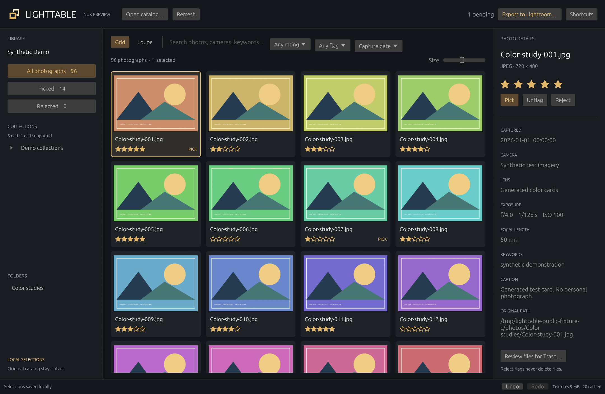

# Lighttable

A native Linux companion for browsing and culling Lightroom Classic catalogs.
**Version 0.1.0 is an alpha:** grid and Loupe browsing, local ratings and flags
work; Lightroom sync and broader catalog compatibility remain experimental.



*Actual app screenshot using generated color cards. No personal photos or catalogs are included.*

## Run a Linux package

Release assets are prepared for [GitHub Releases](https://github.com/adametrnal/lighttable/releases).
The Linux x86_64 tarball targets **Ubuntu 24.04**, requires glibc 2.39 or newer,
Little CMS 2 and working OpenGL drivers, and supports Wayland and X11.
It is not a static executable or AppImage. See [runtime libraries and installation](packaging/README-LINUX.md).

Verify the downloaded files with `sha256sum --check SHA256SUMS`, extract the Linux
tarball to a permanent directory, then run:

```bash
./bin/lighttable
./bin/lighttable "/path/to/My Catalog.lrcat"
python3 scripts/install-desktop.py  # optional per-user applications-menu launcher
```

With no arguments, use **Open catalog…**. Close Lightroom before copying a catalog,
and keep the matching `Previews.lrdata` folder beside it. Try a disposable copy first.
The app supports the observed extensionless JPEG preview layout, with JPEG
original/companion and supported embedded DNG fallbacks. Missing previews are shown explicitly.

For a catalog with one photo root, `--photo-root /mnt/photos` supplies its Linux
location. Per-root mappings for multi-root catalogs are not implemented.

## Build from source

Install the version of Rust specified in [rust-toolchain.toml](rust-toolchain.toml)
using [rustup](https://rustup.rs). On Ubuntu 24.04, install build dependencies:

```bash
sudo apt-get install git curl ca-certificates build-essential pkg-config liblcms2-dev libx11-dev libxi-dev \
  libxrandr-dev libxcursor-dev libxinerama-dev libegl1-mesa-dev libgl1-mesa-dev \
  libwayland-dev libxkbcommon-dev libxkbcommon-x11-0
git clone https://github.com/adametrnal/lighttable.git
cd lighttable
cargo build --release --locked
./run.sh "/path/to/My Catalog.lrcat"
```

`./run.sh` builds the release binary if needed and launches the app. It does not
choose a machine-specific catalog. A project-local toolchain under `.tools/` is
optional; `scripts/cargo-local` also supports it. `Cargo.lock` pins dependencies.

## Browse and choose keepers

- Virtualized thumbnail grid, thumbnail sizing, Loupe, a bounded filmstrip and metadata.
- Search by filename, camera, lens and keywords; filter by folder, rating and flag.
- Expandable ordinary collections and sets, including separate virtual-copy identities.
- Experimental date/rating Smart Collections; unsupported rules explain their limits.
- Multi-selection, stars, picks/rejects, durable local saves and session undo/redo.
- Export selections for the experimental Lightroom companion.
- Reviewed file moves to desktop Trash; rejecting a photo never deletes it.

| Key | Action |
| --- | --- |
| G / E | Grid / Loupe |
| Arrow keys | Navigate |
| 0–5 | Clear / set stars |
| P / X / U | Pick / reject / unflag |
| Ctrl / Shift + click | Toggle / range selection |
| Ctrl+A | Select filtered photos |
| Ctrl+Z / Ctrl+Shift+Z | Undo / redo in the current session |
| Delete | Review selected files for Trash |
| F / Ctrl+O | Fullscreen / open catalog |

Double-click a photo for Loupe. **100% preview** displays the larger preview at
pixel scale; drag to pan. Its resolution may be below the original's.
Ratings and flags apply to all selected photos, including in Loupe. Filters can
remove a photo immediately after a rating or flag changes.

## Local selections and experimental sync

The app reads a private database snapshot and never issues SQL updates against
the source `.lrcat` or changes Develop settings. Selections live separately in
`$XDG_DATA_HOME/lighttable/selections.sqlite`, usually
`~/.local/share/lighttable/selections.sqlite`. Use `--data-dir /path/to/state` for
an isolated profile. Keep this database to retain edits.

Catalogs are namespaced by canonical path. Opening a catalog at a new location
creates a separate set of local selections. Preserve its Linux path when copying
an updated catalog back, or export pending changes first.

To try the companion on disposable catalog copies:

1. Rate/flag photos on Linux and choose **Export to Lightroom…**.
2. Copy the exported TSV and `lightroom/Lighttable.lrplugin` to the Lightroom computer.
3. Add the folder in **File → Plug-in Manager**.
4. In the corresponding catalog, choose **Library → Plug-in Extras → Import Lighttable selections…**.
5. Review the target, update count and conflicts, then verify the changes in Lightroom.
6. Close Lightroom, copy the updated catalog back to its original Linux path and refresh Lighttable.

The importer matches photo UUID, filename and virtual-copy status, checks rating/flag
conflicts and rechecks inside Lightroom's write gate. File UUID is diagnostic only.
Parser and conflict tests pass, but **the companion has not been validated inside
Lightroom Classic here**. Automatic catalog removal and import receipts are not implemented.

Direct SQL writing remains a separate copy-only research tool. The
[Windows experiment](docs/WINDOWS_SYNC_RESULTS.md) confirmed nine test selections
but found missing native edit bookkeeping and unrelated cloud changes.
There is no production direct-write command or button in the app.

## Trash behavior

The review lists resolved originals, declared JPEG companions and matching
XMP/ACR sidecars. Shared virtual-copy originals, companions used by unselected
catalog records and symlinks are protected. Files are revalidated before moving.

Only the review's final button moves files. There is no permanent-delete fallback.
If a mount cannot provide Trash, the move fails and reports the file.
Restore through the desktop file manager. Moves do not remove Lightroom catalog
entries or previews; review those entries in Lightroom. Use expendable copies to test.

## Alpha limits and validation

The reader has been exercised on 32-record and 79,393-record catalogs; broad
schema/version compatibility is unverified. Supported Smart rules cover date
and rating criteria, not Lightroom's full rule language.

A 192 MiB texture budget and three bounded decoder workers limit residency;
decoder/upload memory is additional. Metadata loads in memory on a background
thread. Persistent indexing and disk thumbnail caching remain future work.

Embedded ICC/Adobe RGB previews convert to sRGB. Monitor profiles and HDR are
not integrated. Older packed `.lrprev` containers, arbitrary raw decoding,
Smart-Preview-only decoding and mirrored orientation codes are unsupported.
Fallback previews may differ from Lightroom edits.

See [validation](docs/VALIDATION.md), [collection support](docs/COLLECTIONS.md)
and [Smart rules](docs/SMART_COLLECTIONS.md) for evidence and limits.

## Development checks

Install Python 3.11+, Pillow, Lua, LuaJIT, Xvfb, Xauth, Mesa software rendering and
desktop-file-utils for the full release checks. On Ubuntu 24.04:

```bash
sudo apt-get install python3 python3-pil lua5.4 luajit xvfb xauth libgl1-mesa-dri desktop-file-utils
bash scripts/check.sh
python3 scripts/make-demo-catalog.py /tmp/lighttable-demo
target/release/lighttable --inspect "/tmp/lighttable-demo/Synthetic Demo.lrcat"
```

For inspection, use `target/release/lighttable --inspect "/path/to/catalog.lrcat"`;
add `--verify-previews` to decode every preview. `--benchmark CATALOG COUNT`
measures synthetic metadata filtering only.

The generated catalog is a Lighttable test fixture, not a complete catalog for
Lightroom. The desktop smoke test uses isolated state, saves ratings/flags,
checks grid/Loupe navigation, nested collections and Smart membership/undo, and
takes screenshots. It never runs Trash operations.

[Contributing](CONTRIBUTING.md) · [Release preparation](docs/RELEASING.md)

Lighttable's code and original artwork use the [MIT license](LICENSE).
See [third-party notices](THIRD_PARTY.md) for dependency and embedded-font terms.
This project is independent of Adobe.
