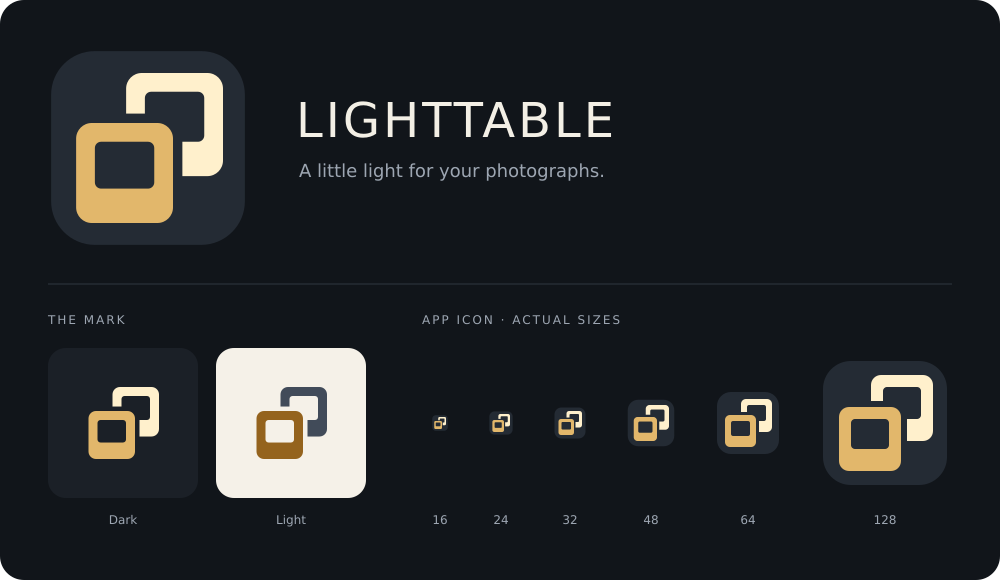

# Lighttable logo and desktop icons

The logo is a pair of photographic slide mounts resting on a light table. The front slide uses the app's amber accent; the cream slide behind it suggests transmitted light. A transparent gap separates the mounts, and both image openings are transparent. The heavier lower borders evoke physical slide mounts and keep the silhouette readable at small sizes.



## Sources and exports

- `assets/branding/lighttable-mark.svg` is the original, editable source on a 64 × 64 grid. It contains only vector geometry and a mask, with no external images or fonts.
- `assets/branding/lighttable-mark.png` is a 128-pixel transparent export, embedded in the binary and displayed at 32 logical pixels in the header. The texture is loaded once at startup.
- `assets/branding/lighttable-mark-light.svg` uses darker colors for pale backgrounds.
- `assets/icons/hicolor/scalable/apps/lighttable-catalog.svg` adds the dark rounded app tile.
- `assets/icons/hicolor/{size}x{size}/apps/lighttable-catalog.png` provides 16, 24, 32, 48, 64, 128, 256 and 512-pixel exports. The binary embeds the 256-pixel version for its window icon.
- `assets/icons/hicolor/symbolic/apps/lighttable-catalog-symbolic.svg` is the monochrome variant for symbolic icon contexts.
- `assets/branding/preview.svg` and `.png` show the variants and small icons at actual pixel sizes when viewed at 100%.

| Use | Color |
| --- | --- |
| Amber foreground | `#E2B76B` |
| Cream rear slide | `#FFF0CC` |
| App tile | `#242B34` |
| Amber on light backgrounds | `#94631D` |
| Rear slide on light backgrounds | `#414B59` |

The artwork is original project artwork under the project's MIT license. The preview sheet uses system DejaVu Sans for labels; the icon artwork itself requires no font.

## Regenerate

Install Python 3 and `rsvg-convert` from librsvg, then run from the project root:

```bash
python3 scripts/build-icons.py
bash scripts/cargo-local build --release --locked
```

Edit the original mark, then regenerate the other assets. The script derives the color variants, desktop tile, all PNG exports and preview sheet from that source. Committed PNGs let normal Rust builds work without SVG tooling or runtime asset files.

## Linux launcher

After building the release binary:

```bash
python3 scripts/install-desktop.py
```

This installs `lighttable-catalog.desktop` in `$XDG_DATA_HOME/applications` and ten icon assets below `$XDG_DATA_HOME/icons/hicolor` (normally `~/.local/share`). It touches only Lighttable's named files and the icon directory modification time. The launcher points to this checkout's release binary using an absolute path, so rebuilding updates the application it starts. If the checkout moves, rerun the installer. It does not copy the executable or change catalog/selection files.

The application ID, desktop filename, icon name and startup window class all use `lighttable-catalog`, avoiding a collision with existing photo applications' `lighttable` action icons. Wayland uses the desktop entry to associate the window with its icon; the native icon is supplied for platforms that support it. Existing app windows must be restarted to use the new build. Some desktops may take time to refresh cached launcher icons.

To inspect the complete installation without writing to your applications folder:

```bash
python3 scripts/install-desktop.py --data-home /tmp/lighttable-desktop-check
desktop-file-validate /tmp/lighttable-desktop-check/applications/lighttable-catalog.desktop
```

`--binary /absolute/path/to/lighttable` selects another built executable. Paths containing spaces, quotes, dollar signs, backticks and backslashes are quoted using the [Desktop Entry Exec specification](https://specifications.freedesktop.org/desktop-entry/latest/exec-variables.html). The helper rejects control characters, `=` and `%` in executable paths for desktop compatibility; GIO on the test machine could not resolve an executable containing a percent sign even when escaped as specified.

For later distribution packaging, `assets/linux/lighttable-catalog.desktop` is a portable entry using `Exec=lighttable %f`; install the binary on `PATH` and the icons in the corresponding hicolor directories.
